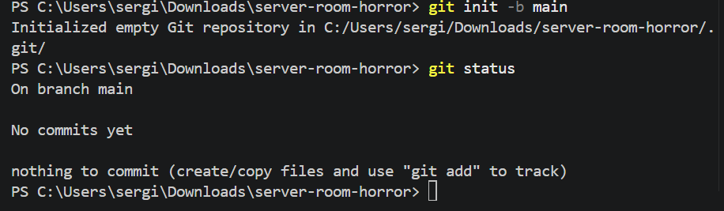
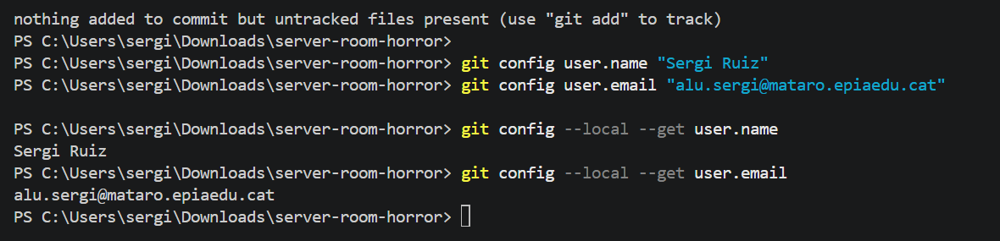
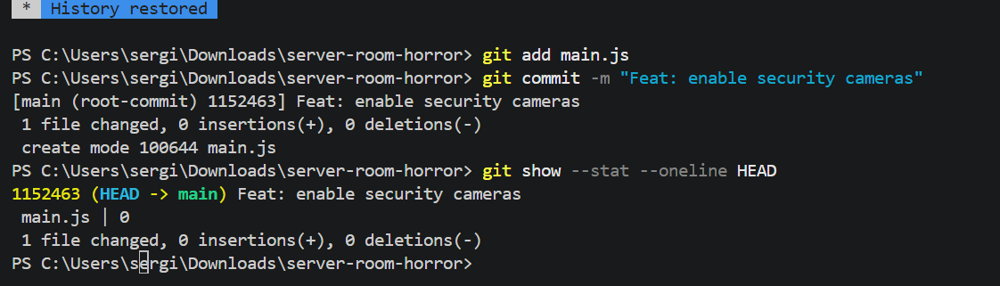
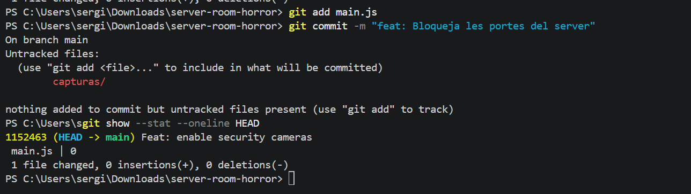
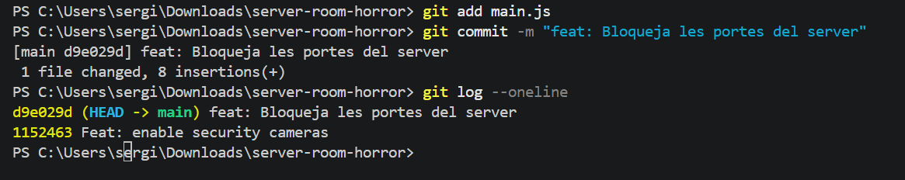

# Bloc 1: Invocació del Repositori i Línia Base

## Acció 3.1

**Explicació:** He preparat la carpeta `server-room-horror` i hi he iniciat Git amb la branca `main`. Després he consultat l'estat per comprovar que encara no hi havia cap commit. La captura comença dins de la carpeta i no mostra la comanda que he fet servir per crear-la.

**Comandes utilitzades:**

```bash
git init -b main
git status
```

**Captura:**



## Acció 3.2

**Explicació:** He configurat el meu nom i el meu correu per identificar els commits d'aquest repositori. Després he consultat els dos valors per comprovar que s'havien guardat bé.

**Comandes utilitzades:**

```bash
git config user.name "Sergi Ruiz"
git config user.email "alu.sergi@mataro.epiaedu.cat"
git config --local --get user.name
git config --local --get user.email
```

**Captura:**



## Acció 3.3

**Explicació:** He afegit `main.js` al repositori i he fet el primer commit amb el missatge `Feat: enable security cameras`. Després he consultat el resum del commit, que té l'identificador `1152463`. Tot i el missatge, el fitxer d'aquest primer commit és buit; no puc dir que ja hi hagués codi de càmeres.

**Comandes utilitzades:**

```bash
git add main.js
git commit -m "Feat: enable security cameras"
git show --stat --oneline HEAD
```

**Captura:**


La captura no mostra com he creat el fitxer. Comanda o manera de crear-lo: **[pendent de completar]**.

## Acció 3.4

**Explicació:** He intentat fer un commit per bloquejar les portes, però Git m'ha indicat que no hi havia canvis per guardar. Després he modificat el fitxer i he pogut crear el commit `d9e029d` amb el missatge `feat: Bloqueja les portes del server`. Amb aquestes evidències només puc acreditar una modificació amb commit després del primer; em falta una altra modificació amb un commit separat.

**Comandes utilitzades:**

Primer intent, sense crear cap commit:

```bash
git add main.js
git commit -m "feat: Bloqueja les portes del server"
git show --stat --oneline HEAD
```

Segon intent, amb el commit creat:

```bash
git add main.js
git commit -m "feat: Bloqueja les portes del server"
```

**Captura:**



(capturas/Captura5.png)

Segona modificació i commit separat: **[pendent d'aportar el canvi, el missatge, l'identificador i la captura]**. No compto l'intent fallit com un commit nou.

## Acció 3.5

**Explicació:** He consultat l'historial amb `git log --oneline` per veure els commits de manera resumida. A la captura hi veig dos commits: `d9e029d` i `1152463`, amb el més recent a dalt. Això em permet comprovar quins canvis he guardat fins a aquest moment.

**Comandes utilitzades:**

```bash
git log --oneline
```

**Captura:**



He reutilitzat la captura 5 perquè mostra tant el commit de l'acció anterior com la consulta de l'historial.
