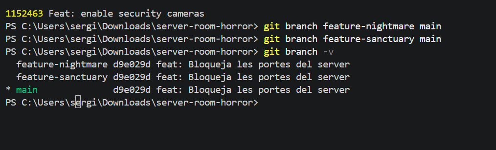
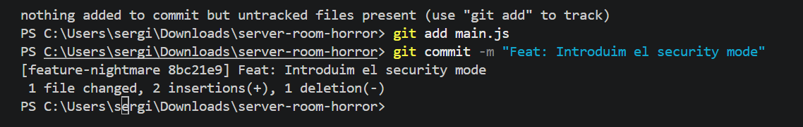
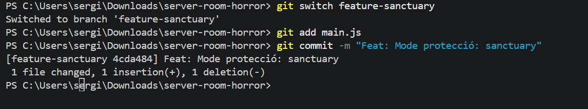
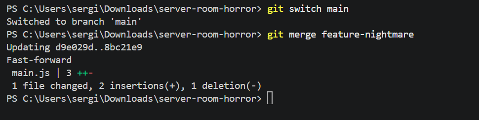
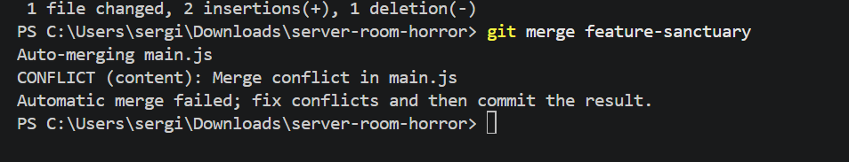
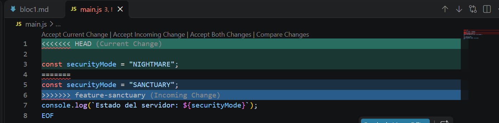
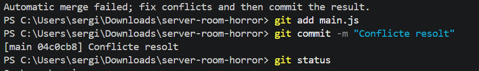

# Bloc 2: Les Branques del Més Enllà i Resolució del Conflicte

## Acció 3.6

**Explicació:** He creat `feature-nightmare` i `feature-sanctuary` des de `main`, abans de fer canvis en cap de les dues. Així totes dues surten del mateix commit, Amb `git branch -v` he comprovat aquest punt de partida.

**Comandes utilitzades:**

```bash
git branch feature-nightmare main
git branch feature-sanctuary main
git branch -v
```

**Captura:**



## Acció 3.7

**Explicació:** A `feature-nightmare` he canviat la línia de `securityMode` perquè tingui el valor `NIGHTMARE`. He guardat el canvi al commit `Feat: Introduim el security mode`. Puc comprovar el valor al fitxer guardat en aquesta branca i a la captura del conflicte de l'acció 3.9.

**Comandes utilitzades:**

```bash
git add main.js
git commit -m "Feat: Introduim el security mode"
```

**Captura:**



No tinc `Captura7.png`. La captura 8 acredita el commit, però no mostra la comanda per entrar a la branca ni l'edició del fitxer; aquesta evidència queda **[pendent de completar]**.

## Acció 3.8

**Explicació:** He entrat a `feature-sanctuary` i he canviat la mateixa línia de `main.js` per posar-hi `SANCTUARY`. Després he guardat el canvi al commit, amb el missatge `Feat: Mode protecció: sanctuary`. D'aquesta manera tinc dues versions diferents de la mateixa línia, cadascuna en una branca.

**Comandes utilitzades:**

```bash
git switch feature-sanctuary
git add main.js
git commit -m "Feat: Mode protecció: sanctuary"
```

**Captura:**



## Acció 3.9

**Explicació:** He tornat a `main` i hi he fusionat `feature-nightmare`; aquesta primera fusió ha entrat directament. Després he intentat fusionar `feature-sanctuary` i Git m'ha avisat d'un conflicte a `main.js`, perquè les dues branques havien canviat la mateixa línia. A Visual Studio he pogut veure les dues opcions separades per les marques

**Comandes utilitzades:**

```bash
git switch main
git merge feature-nightmare
git merge feature-sanctuary
```

**Captura:**







## Acció 3.10

**Explicació:** He editat `main.js`, he tret les marques i he eliminat la línia amb `NIGHTMARE`. M'he quedat amb `SANCTUARY` perquè és la versió segura que demana la pràctica, i aquest valor es pot comprovar al commit final. Després he guardat la resolució al commit de fusió `04c0cb8`, amb el missatge `Conflicte resolt`.

**Comandes utilitzades:**

```bash
git add main.js
git commit -m "Conflicte resolt"
git status
```

**Captura:**


